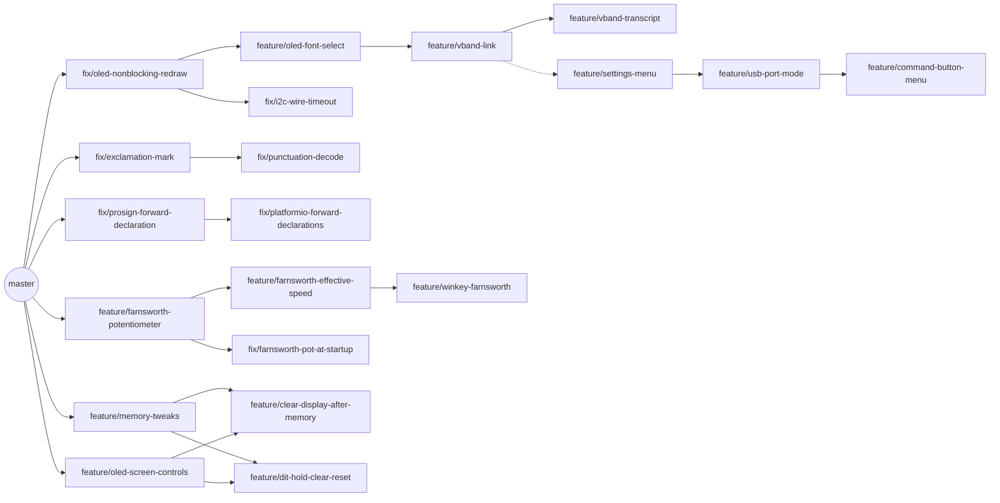

# Upstream map

Every fix and feature in this fork, mapped back to upstream [K3NG](https://github.com/k3ng/k3ng_cw_keyer) `master`:
what each branch is cut from, what it needs first, whether it's in this build, and how ready it is to offer upstream.
None of them has been offered upstream; whether and when to do that is the fork owner's call. This file keeps them
in a state where that would be easy.

`tools/keyer-upstream/` in the [Stellaluna hub](https://github.com/W7YFR/stellaluna) checks this file against git
(`make keyer-upstream`): every branch listed, the bases right, the "In `w7yfr`" column true, and upstream `master`
not moved on.

## How upstream takes changes

As of 2026-10, from upstream's history:

- Changes arrive as pull requests against `k3ng/k3ng_cw_keyer` `master`. Upstream builds with the Arduino IDE and
  has no CI.
- Small, single-purpose pull requests get merged ("Ultimatic Mode Bug", "Fix not working DFRobot LCD Keypad
  buttons", "Added #define HI_TEXT"). Large ones sit open for years (RP2040 support, renaming the files).
- New behavior goes behind a `FEATURE_` / `OPTION_` define, off by default, listed in every hardware profile's
  files. Upstream records each change in the version history at the top of `k3ng_keyer.ino`.
- Upstream `master` was quiet from 2026-06 ("Add ESP32 support", #162) until 2026-10-15/16, when K3NG pushed
  small fixes (some pulled forward from old branches), a version bump and a new chapter of the Noise story. The
  branches here are cut from the 2026-06 commit; each is rebased on current `master` when it's about to be offered,
  not all at once whenever upstream moves. `w7yfr` merges upstream `master` as it moves.

## Before offering a branch

1. **Current base.** Cut from current upstream `master`, or stacked on a branch that goes first. If upstream has
   moved on, rebase (the check script reports this).
2. **One purpose.** Nothing from this build's configuration (`w7yfr`'s pins, features, `platformio.ini`), no
   unrelated changes. Fixes to our own unoffered features are folded into that feature's branch first.
3. **Every board.** New defines listed, off or with a safe default, in every `keyer_features_and_options_*.h`,
   `keyer_settings_*.h` and `keyer_pin_settings_*.h`, including `*_test_everything.h`.
4. **Builds.** `make keyer-matrix KEYER=<worktree>` in the hub: no `FAIL` lines (`old` is upstream's own).
5. **Tested.** Say how: everything in `w7yfr` runs on the Stellaluna Keyer (Arduino Mega 2560, SSD1306 OLED).
6. **Explained.** The pull request says what was wrong or missing, what changed, and how it was tested. Upstream's
   version history line can be offered in the description rather than edited in.

## How the branches stack

Branches not shown are cut straight from `master`. An arrow means "cut from"; dashed means "contains an earlier
version of".

`feature/settings-menu` holds all but the newest commit of `feature/vband-link`: it was cut from it before that
commit.

## Branches

**Upstream** is how ready a branch is to offer: **ready** (meets the checklist as far as is known; run the matrix
first), **needs work** (what's in the notes below), or **not for upstream** (specific to this build). **Status** is
**not offered** for all of them so far. **In `w7yfr`**: **yes** (merged), or **copy** with the commit that carries
the same change (it was committed on `w7yfr` directly).

| Branch | Kind | Based on | In `w7yfr` | Upstream | Status | What it does |
|---|---|---|---|---|---|---|
| `fix/async-eeprom-write-overrun` | fix | `master` | yes | ready | not offered | The background settings write wrote one byte past the configuration. Upstream has the bug |
| `fix/power-on-serial-button` | fix | `master` | yes | ready | not offered | The command button held at power-on picks the other USB port mode (it was read before the button ladder was set up). Upstream has the bug |
| `fix/speed-pot-at-startup` | fix | `master` | yes | ready | not offered | At power-on the speed is the speed pot's position, not the saved speed; a pot at the bottom no longer reads as 0 wpm. Upstream has the bug |
| `fix/straight-key-echo-without-cli` | fix | `master` | yes | ready | not offered | `FEATURE_STRAIGHT_KEY_ECHO` with a display builds without the CLI. Upstream has the bug |
| `fix/prosign-sos-and-warnings` | fix | `master` | yes | ready | not offered | Decoding SOS no longer sends it; `paddle_pin_read()` always returns; compiler warnings. Upstream has the bugs |
| `fix/exclamation-mark` | fix | `master` | yes | ready | not offered | `!` is sent and decoded as `-.-.--` (it was sent as a comma). Upstream has the bug |
| `fix/punctuation-decode` | fix | `fix/exclamation-mark` | yes | ready | not offered | `;` `$` `'` `"` `_` `)` decode from the paddles |
| `fix/echo-practice` | fix | `master` | copy `1dfe152` | ready | not offered | `%` is sent and tracked in echo practice. Upstream has the bug |
| `chore/build-warnings` | chore | `master` | copy `1153f70` | ready | not offered | Compiler warnings (unused variables, a stray `#endif;`) |
| `fix/prosign-forward-declaration` | fix | `master` | yes | ready | not offered | `convert_prosign()` declared ahead, so builds outside the Arduino IDE compile |
| `fix/platformio-forward-declarations` | fix | `fix/prosign-forward-declaration` | yes | ready | not offered | More functions declared ahead, so other boards' profiles build outside the Arduino IDE |
| `build/platformio` | build | `master` | yes | needs work | not offered | A `platformio.ini` and the fixes PlatformIO needs |
| `fix/oled-nonblocking-redraw` | fix | `master` | yes | needs work | not offered | SSD1306 redraws no longer block paddle handling |
| `fix/i2c-wire-timeout` | fix | `fix/oled-nonblocking-redraw` | yes | needs work | not offered | A stuck I2C bus no longer freezes the keyer (a `Wire` timeout) |
| `feature/oled-font-select` | feature | `fix/oled-nonblocking-redraw` | yes | ready | not offered | Selectable SSD1306 font |
| `feature/oled-screen-controls` | feature | `master` | yes | ready | not offered | SSD1306 display controls; scroll position reset |
| `feature/display-msg-delay-setting` | feature | `master` | yes | ready | not offered | A settings file can set `default_display_msg_delay` |
| `feature/build-revision` | feature | `master` | yes | ready | not offered | `-D FIRMWARE_GIT_REV=<commit>` shows the commit on the startup screen and boot message |
| `feature/button-press-duration` | feature | `master` | yes | ready | not offered | `button_hold_threshold_ms`: press vs hold on the buttons |
| `feature/extra-button` | feature | `master` | yes | ready | not offered | `EXTRA_BUTTONS`: buttons on the ladder beyond the command and memory buttons |
| `feature/straight-key-paddle` | feature | `master` | yes | ready | not offered | `FEATURE_STRAIGHT_KEY_PADDLE`: the dit paddle as a straight key |
| `feature/paddle-echo-practice` | feature | `master` | yes | ready | not offered | Echo practice from the paddles, no serial terminal, the target on the display |
| `feature/memory-tweaks` | feature | `master` | yes | ready | not offered | `OPTION_SKIP_SAVED_MEMORY_PLAYBACK`, restart a recording, characters shown during playback, saved at the configured speed |
| `feature/clear-display-after-memory` | feature | `feature/memory-tweaks` + `feature/oled-screen-controls` | copy `b6525dc` | ready | not offered | Clears the display's running text when recording a memory starts, restarts and ends |
| `feature/dit-hold-clear-reset` | feature | `feature/memory-tweaks` + `feature/oled-screen-controls` | yes | ready | not offered | `FEATURE_DIT_HOLD_RESET`: clear or reset the display with a run of dits |
| `feature/farnsworth-potentiometer` | feature | `master` | yes | needs work | not offered | `FEATURE_FARNSWORTH_POTENTIOMETER`: a pot for the Farnsworth speed |
| `fix/farnsworth-pot-at-startup` | fix | `feature/farnsworth-potentiometer` | yes | needs work | not offered | At power-on the Farnsworth speed is the Farnsworth pot's position |
| `feature/farnsworth-effective-speed` | feature | `feature/farnsworth-potentiometer` | yes | ready | not offered | `OPTION_FARNSWORTH_SETS_EFFECTIVE_SPEED`: the speed is the character speed, Farnsworth the effective speed |
| `feature/winkey-farnsworth` | feature | `feature/farnsworth-effective-speed` | yes | ready | not offered | Winkey hosts' speeds translated under that option; the pots set the speeds while a host is open |
| `feature/vband-link` | feature | `feature/oled-font-select` | yes | not for upstream | not offered | `FEATURE_VBAND_LINK`: the link to Stellaluna's ESP32 VBand adapter |
| `feature/vband-transcript` | feature | `feature/vband-link` | yes | not for upstream | not offered | Prints the adapter's VBand transcript on the USB port; no CLI echo of your sending while it's on |
| `feature/settings-menu` | feature | `feature/vband-link` | yes | needs work | not offered | `FEATURE_SETTINGS_MENU`: settings by name, from a menu, keyed shortcuts and the CLI |
| `feature/command-button-menu` | feature | `feature/usb-port-mode` | yes | needs work | not offered | The Cmd button setting: the command button opens command mode or the settings menu |
| `feature/usb-port-mode` | feature | `feature/settings-menu` | yes | needs work | not offered | The USB port setting: CLI or Winkey, saved, switched without a power cycle |

## Notes on the ones that need work

- **`build/platformio`:** tooling upstream may not want (a pull request renaming files for developers has sat open
  since 2022). The forward declaration fixes stand on their own without it.
- **`fix/oled-nonblocking-redraw`:** changes how every SSD1306 redraw works (about 300 lines). Worth offering, but
  as its own pull request with a clear description, before the display features stacked on it.
- **`fix/i2c-wire-timeout`:** doesn't need the redraw change; re-cut it from `master` so it can go alone.
- **`feature/farnsworth-potentiometer` and `fix/farnsworth-pot-at-startup`:** the fix is to our own feature, so
  fold it into the feature's branch before offering it (one branch, no separate fix).
- **`feature/settings-menu`:** it was cut from `feature/vband-link`, and its VBand rows depend on it (behind
  `FEATURE_VBAND_LINK`). To offer it, re-cut it from `feature/oled-font-select` without the VBand link, and expect
  it to be one of the large ones (about 2,400 lines). The keyed shortcuts and CLI parts don't need the display.
- **`feature/usb-port-mode`:** needs the settings menu (its setting lives there). It goes after a re-cut
  `feature/settings-menu`.

## A sensible order

1. **Bug fixes cut from `master`**, one pull request each: `fix/async-eeprom-write-overrun`,
   `fix/power-on-serial-button`, `fix/speed-pot-at-startup`, `fix/straight-key-echo-without-cli`,
   `fix/prosign-sos-and-warnings`, `fix/exclamation-mark` then `fix/punctuation-decode`, `fix/echo-practice`,
   `chore/build-warnings`.
2. **Builds outside the Arduino IDE:** `fix/prosign-forward-declaration` then `fix/platformio-forward-declarations`.
3. **Small options:** `feature/display-msg-delay-setting`, `feature/button-press-duration`,
   `feature/straight-key-paddle`, `feature/build-revision`.
4. **The display:** `fix/oled-nonblocking-redraw`, `fix/i2c-wire-timeout` (re-cut), `feature/oled-font-select`,
   `feature/oled-screen-controls`.
5. **Larger features:** `feature/memory-tweaks`, then `feature/clear-display-after-memory` and
   `feature/dit-hold-clear-reset`; `feature/extra-button`; `feature/paddle-echo-practice`; the Farnsworth stack
   (the pot with its fix folded in, then the effective speed, then Winkey).
6. **Later, if at all:** `feature/settings-menu` (re-cut) and `feature/usb-port-mode`. `feature/vband-link` stays
   here.

## Keeping this current

When a branch is created, merged into `w7yfr`, offered or merged upstream, update its row, then run
`make keyer-upstream` in the hub.
